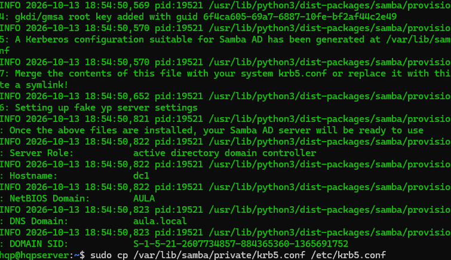
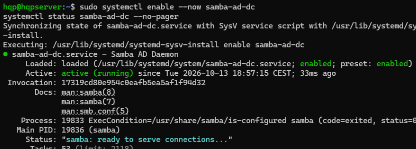
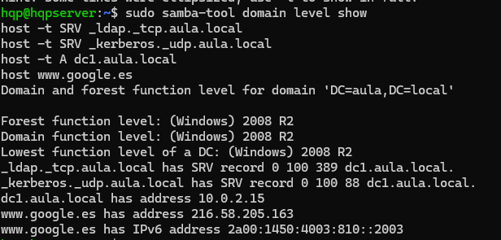
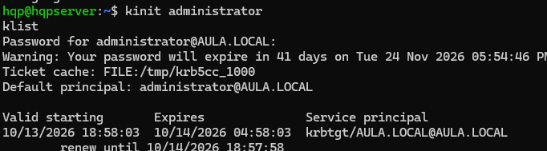
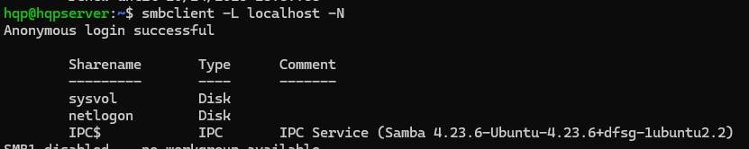
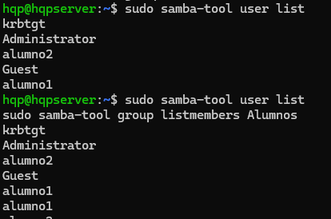

# Controlador de dominio Active Directory con Samba

Montaje de un dominio **Active Directory** (`aula.local`) sobre **Ubuntu Server** usando **Samba** como controlador de dominio, con DNS integrado y autenticación **Kerberos**, preparado para que equipos Windows se unan al dominio.

Práctica de *Administración de Sistemas Operativos* (2º ASIR).

## Entorno

| Elemento | Valor |
|---|---|
| Virtualización | VirtualBox, red NAT `RedASIR` (192.168.100.0/24) |
| Servidor | Ubuntu Server 24.04 LTS, nombre `dc1` |
| Dominio | `aula.local` (NetBIOS `AULA`, reino Kerberos `AULA.LOCAL`) |
| Rol | Active Directory Domain Controller, nivel funcional 2008 R2 |
| Cliente | Windows 11 Pro |

## Procedimiento

### 1. Preparar el servidor

```bash
sudo hostnamectl set-hostname dc1
sudo timedatectl set-timezone Europe/Madrid
# IP fija en /etc/netplan/50-cloud-init.yaml y entrada de dc1.aula.local en /etc/hosts
sudo netplan apply
```

### 2. Instalar Samba y Kerberos

```bash
sudo apt update
sudo apt install -y samba-ad-dc krb5-user winbind smbclient dnsutils
```

### 3. Provisionar el dominio

Se detienen los servicios de Samba "clásico" (servidor de ficheros) y se aparta su configuración, porque un controlador de dominio usa un servicio distinto (`samba-ad-dc`).

```bash
sudo systemctl disable --now smbd nmbd winbind
sudo systemctl unmask samba-ad-dc
sudo mv /etc/samba/smb.conf /etc/samba/smb.conf.orig

sudo samba-tool domain provision --use-rfc2307 --interactive
sudo cp /var/lib/samba/private/krb5.conf /etc/krb5.conf
```

### 4. DNS y arranque del controlador

El DNS de Ubuntu (`systemd-resolved`) se desactiva para que el servidor se resuelva a sí mismo con el DNS interno de Samba ([`config/resolv.conf`](config/resolv.conf)).

```bash
sudo systemctl disable --now systemd-resolved
sudo rm -f /etc/resolv.conf     # y se crea de nuevo apuntando a 127.0.0.1
sudo systemctl enable --now samba-ad-dc
```

### 5. Verificación

```bash
sudo samba-tool domain level show
host -t SRV _ldap._tcp.aula.local
host -t SRV _kerberos._udp.aula.local
host -t A dc1.aula.local
kinit administrator && klist
smbclient -L localhost -N        # recursos sysvol y netlogon
```

### 6. Usuarios y grupos

```bash
sudo samba-tool user create alumno1
sudo samba-tool user create alumno2
sudo samba-tool group add Alumnos
sudo samba-tool group addmembers Alumnos alumno1,alumno2

sudo samba-tool user list
sudo samba-tool group listmembers Alumnos
```

### 7. Unir un cliente Windows

En el cliente se configura como DNS la IP del controlador, se comprueba con `nslookup aula.local` y se une el equipo al dominio desde *Configuración > Sistema > Información > Dominio o grupo de trabajo*, con las credenciales de `administrator`. Desde el servidor, el equipo aparece con `sudo samba-tool computer list`.

## Evidencias

| | |
|---|---|
|  |  |
| Dominio provisionado | Servicio `samba-ad-dc` activo |
|  |  |
| Registros SRV de LDAP y Kerberos | Ticket Kerberos de `administrator` |
|  |  |
| Recursos `sysvol` y `netlogon` | Usuarios y miembros del grupo `Alumnos` |

## Conceptos clave

- **Samba AD DC** implementa los protocolos de Active Directory (LDAP, Kerberos, DNS, SMB), por lo que un Windows se une al dominio igual que a uno de Windows Server.
- **Kerberos** autentica por tickets y depende de que la hora y el DNS sean correctos.
- Los registros **SRV** (`_ldap._tcp`, `_kerberos._udp`) son los que usan los clientes para localizar el controlador de dominio.
- **sysvol** y **netlogon** son los recursos compartidos donde el dominio guarda scripts y directivas de grupo.
